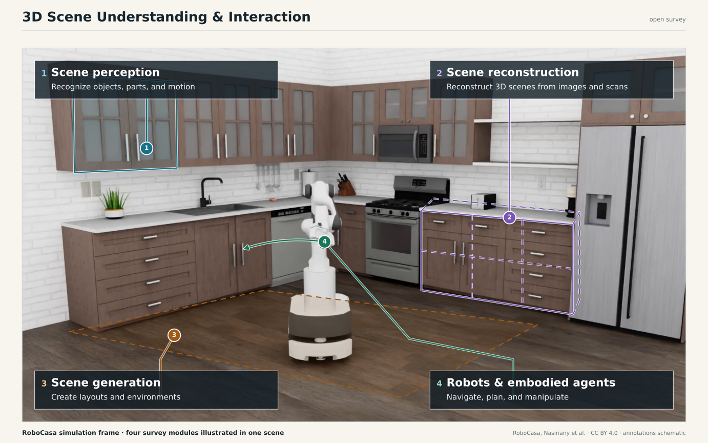

# Awesome 3D Scene Understanding and Interaction

> Perception, reconstruction, generation, robotic manipulation, and embodied agents.

## Contents

| Reading routes | Topic collections |
| --- | --- |
| [🏙️ Understand a 3D scene](#route-scene-perception) [🗣️ Connect language, objects, and function](#route-language-and-function) [🏗️ Reconstruct a whole 3D scene](#route-scene-reconstruction) [🌍 Generate scenes and environments](#route-scene-generation) [⚙️ Understand what moves, and how](#route-articulated-perception) [🧩 Build an articulated digital twin](#route-reconstruction) [🛠️ Generate articulated assets](#route-generation) [🧭 Navigate with maps, language, and memory](#route-spatial-navigation) [💡 Reason and answer questions about a 3D world](#route-embodied-reasoning) [🦾 Turn perception into robot interaction](#route-manipulation) [🤖 Connect generalist policies and embodied agents](#route-policies-and-agents) [📊 Choose data and evaluation for your task](#route-data-and-evaluation) | [Scene and functional perception](topics/perception.md) [Scene reconstruction and digital twins](topics/reconstruction.md) [Scene generation and asset authoring](topics/generation.md) [Embodied agents and robotic interaction](topics/robotics.md) [Datasets, simulators, and benchmarks](topics/datasets.md)  **Resources** [Research map](#research-map) [Paper index](PAPERS.md) [Benchmark guide](BENCHMARKS.md) [Contributing](CONTRIBUTING.md) |

A collection of papers and resources on 3D scene understanding, reconstruction, generation, and embodied interaction. Topics span scene geometry and appearance, spatial reasoning, generated environments, navigation, manipulation, and articulated objects.

Explore the reading routes, illustrated chapters, and searchable paper library on the website: [English](https://hyokong.github.io/Awesome-3D-Scene-Understanding-and-Interaction/) · [中文](https://hyokong.github.io/Awesome-3D-Scene-Understanding-and-Interaction/zh/).

## Reading routes

Follow a route in order, or jump to the part you need. Papers grouped in one stage offer complementary approaches; each linked entry includes project and code resources where available.

### 🏙️ Understand a 3D scene

*Point features → semantic labels → object instances*

Connect point-cloud representations to the objects and regions a scene contains.

| Stage | Suggested reading | What to look for |
| --- | --- | --- |
| **1. Learn point representations** | [PointNet](PAPERS.md#pointnet) · [PointNet++](PAPERS.md#pointnet-plus-plus) | Compare whole-set features with hierarchical local geometry. |
| **2. Compare scalable backbones** | [PTv3](PAPERS.md#ptv3) · [Volt](PAPERS.md#volume-transformer) | Compare point serialization with volumetric patch tokens and global attention. |
| **3. Separate object instances** | [Mask3D](PAPERS.md#mask3d) · [OneFormer3D](PAPERS.md#oneformer3d) | Follow the change from point features to semantic, instance, and panoptic predictions. |
| **4. Transfer and generalize representations** | [DITR](PAPERS.md#ditr) · [PPT](PAPERS.md#multi-dataset-point-prompt-training) | Compare transferred 2D features with training across multiple 3D datasets. |

**Try it:** For a kitchen scan, sketch the difference between a semantic map, an instance map, and a panoptic map.

**Explore more:** [Scene and functional perception](topics/perception.md) · [Datasets, simulators, and benchmarks](topics/datasets.md) · [Back to contents](#contents)

### 🗣️ Connect language, objects, and function

*Open vocabulary → scene relations → actionable parts*

Move from naming objects to locating the parts and relationships relevant to a task.

| Stage | Suggested reading | What to look for |
| --- | --- | --- |
| **1. Build a queryable 3D map** | [OpenScene](PAPERS.md#openscene) · [ConceptFusion](PAPERS.md#conceptfusion) | See how visual and language features support queries beyond a fixed label set. |
| **2. Ground queries in instances** | [OpenMask3D](PAPERS.md#openmask3d) · [Open3DIS](PAPERS.md#open3dis) | Compare how 2D observations and 3D proposals produce object-level masks. |
| **3. Add language and relations** | [ScanRefer](PAPERS.md#scanrefer) · [ConceptGraphs](PAPERS.md#conceptgraphs) | Contrast referring-expression localization with a scene graph for reasoning and planning. |
| **4. Identify functional regions** | [SceneFun3D](PAPERS.md#scenefun3d) · [GAPartNet](PAPERS.md#gapartnet) | Relate task descriptions and affordances to actionable parts and part poses. |

**Try it:** Compare the regions needed for 'find the refrigerator' and 'open the refrigerator': object, door, handle, and action space.

**Explore more:** [Scene and functional perception](topics/perception.md) · [Embodied agents and robotic interaction](topics/robotics.md) · [Back to contents](#contents)

### 🏗️ Reconstruct a whole 3D scene

*Camera geometry → neural representations → learned geometry → online mapping*

Compare ways to recover scene structure and appearance from images, depth, and video.

| Stage | Suggested reading | What to look for |
| --- | --- | --- |
| **1. Recover cameras and geometry** | [COLMAP](PAPERS.md#colmap-sfm) · [BundleFusion](PAPERS.md#bundlefusion) | Compare image-based structure from motion with globally consistent RGB-D fusion. |
| **2. Represent scene appearance** | [NeRF](PAPERS.md#nerf) · [3D Gaussian Splatting](PAPERS.md#gaussian-splatting) | Contrast a continuous radiance field with explicit Gaussian primitives; separate rendering quality from surface geometry. |
| **3. Predict geometry directly** | [DUSt3R](PAPERS.md#dust3r) · [VGGT](PAPERS.md#vggt) | Study feed-forward point maps, camera recovery, depth, and multi-view consistency. |
| **4. Map an ongoing observation stream** | [NICE-SLAM](PAPERS.md#nice-slam) · [SplaTAM](PAPERS.md#splatam) | Compare implicit and Gaussian maps jointly updated with camera tracking. |
| **5. Handle a changing scene** | [MonST3R](PAPERS.md#monst3r) · [4D Gaussian Splatting](PAPERS.md#four-d-gaussian-splatting) | Distinguish time-varying geometry and camera estimation from dynamic-scene rendering. |

**Try it:** For one captured room, list which methods need depth, camera poses, multiple views, or scene-specific optimization, and which outputs support rendering or geometry queries.

**Explore more:** [Scene reconstruction and digital twins](topics/reconstruction.md) · [Scene and functional perception](topics/perception.md) · [Back to contents](#contents)

### 🌍 Generate scenes and environments

*Layouts → visual scenes → procedural worlds → interactive simulation*

Follow how scene generation combines room structure, object placement, appearance, and task requirements.

| Stage | Suggested reading | What to look for |
| --- | --- | --- |
| **1. Arrange objects in a scene** | [ATISS](PAPERS.md#atiss) · [DiffuScene](PAPERS.md#diffuscene) | Compare autoregressive layout prediction with diffusion over scene configurations. |
| **2. Control composition with language** | [LayoutGPT](PAPERS.md#layoutgpt) · [InstructScene](PAPERS.md#instructscene) | Study how text conditions become object relations and spatial layouts. |
| **3. Synthesize a visual 3D world** | [Text2Room](PAPERS.md#text2room) · [WonderWorld](PAPERS.md#wonderworld) | Contrast a generated textured room mesh with interactive scene expansion from an image. |
| **4. Generate environments procedurally** | [ProcTHOR](PAPERS.md#procthor) · [Infinigen](PAPERS.md#infinigen) | Compare interactive indoor-house sampling with procedural natural-world geometry and materials. |
| **5. Connect generation to embodied tasks** | [Holodeck](PAPERS.md#holodeck) · [RoboGen](PAPERS.md#robogen) | Read for task-driven scene construction and the interface between generated environments and agent training. |

**Try it:** Give the same room description to a layout generator, a visual scene generator, and a simulator-environment generator. List the different outputs and what each would still need for a robot task.

**Explore more:** [Scene generation and asset authoring](topics/generation.md) · [Datasets, simulators, and benchmarks](topics/datasets.md) · [Back to contents](#contents)

### ⚙️ Understand what moves, and how

*Parts → joints and pose → tracking → scene articulation*

Distinguish movable-part segmentation, motion parameters, articulated pose, and temporal tracking.

| Stage | Suggested reading | What to look for |
| --- | --- | --- |
| **1. Recover parts and motion** | [Shape2Motion](PAPERS.md#shape2motion) · [ANCSH](PAPERS.md#ancsh) | Compare motion-part analysis with category-level pose and canonical part coordinates. |
| **2. Track articulated state** | [CAPTRA](PAPERS.md#captra) | Study how previous-frame estimates support online per-part pose tracking. |
| **3. Work from a single image** | [OPD](PAPERS.md#opd) · [OPDMulti](PAPERS.md#opdmulti) | Follow openable-part detection and axis estimation from single-object to multi-object images. |
| **4. Scale to indoor scenes** | [Articulate3D](PAPERS.md#articulate3d) · [Segment–Snap](PAPERS.md#segment-snap) | Examine scene-level parts, handles, connectivity, and articulation predictions. |

**Try it:** For one door and one drawer, list the part mask, joint type, axis, origin, and state a robot would need.

**Explore more:** [Scene and functional perception](topics/perception.md) · [Scene reconstruction and digital twins](topics/reconstruction.md) · [Back to contents](#contents)

### 🧩 Build an articulated digital twin

*Observations → geometry and motion → executable models*

Recover the geometry, joints, and executable structure of objects that move within a scene.

| Stage | Suggested reading | What to look for |
| --- | --- | --- |
| **1. Observe multiple states** | [Ditto](PAPERS.md#ditto) · [PARIS](PAPERS.md#paris) | Compare before/after interaction observations with multi-view capture in two states. |
| **2. Reconstruct from video** | [Articulat3D](PAPERS.md#articulat3d) · [VideoArtGS](PAPERS.md#videoartgs) | Study geometry, part decomposition, and articulation recovery from monocular video. |
| **3. Produce executable structure** | [Real2Code](PAPERS.md#real2code) · [URDFormer](PAPERS.md#urdformer) | Compare reconstructed parts and articulation code with single-image, mesh-based URDF prediction. |
| **4. Make static assets interactive** | [S2O](PAPERS.md#s2o) · [REACT3D](PAPERS.md#react3d) | Inspect part detection, motion inference, hidden-geometry completion, and scene assembly. |

**Try it:** Make an input/output table: single image, two states, video, or static mesh in; geometry, joints, and executable assets out.

**Explore more:** [Scene reconstruction and digital twins](topics/reconstruction.md) · [Scene generation and asset authoring](topics/generation.md) · [Back to contents](#contents)

### 🛠️ Generate articulated assets

*Part graphs → conditional generation → asset programs*

Understand how geometry and kinematic structure are generated together under different conditions.

| Stage | Suggested reading | What to look for |
| --- | --- | --- |
| **1. Represent the articulation graph** | [NAP](PAPERS.md#nap) · [CAGE](PAPERS.md#cage) | Read for graph representations, part geometry, motion parameters, and structural constraints. |
| **2. Add physical or text conditions** | [PhysNAP](PAPERS.md#physnap) · [ArtFormer](PAPERS.md#artformer) | Compare physical guidance and partial observations with text-conditioned tree generation. |
| **3. Generate from an image** | [SINGAPO](PAPERS.md#singapo) · [PAct](PAPERS.md#pact) | Compare plausible geometry and kinematics inferred from one image. |
| **4. Author assets through programs** | [Articulate-Anything](PAPERS.md#articulate-anything) · [Articraft](PAPERS.md#articraft) | Trace how language/vision models produce programs defining parts, joints, and simulator assets. |

**Try it:** Compare two plausible models of the same closed cabinet: what can the image determine, and what must the generator infer?

**Explore more:** [Scene generation and asset authoring](topics/generation.md) · [Scene reconstruction and digital twins](topics/reconstruction.md) · [Back to contents](#contents)

### 🧭 Navigate with maps, language, and memory

*Spatial maps → semantic goals → language instructions → lifelong navigation*

Connect scene representations to where an agent should move and what it should remember.

| Stage | Suggested reading | What to look for |
| --- | --- | --- |
| **1. Build a language-queryable map** | [VLMaps](PAPERS.md#vlmaps) | Follow visual-language feature fusion into a spatial map for navigation goals and obstacles. |
| **2. Explore toward a semantic goal** | [VLFM](PAPERS.md#vlfm) | Study how frontier exploration and goal recognition guide object-goal navigation. |
| **3. Follow a language instruction** | [LM-Nav](PAPERS.md#lm-nav) | Trace landmarks from language through visual grounding to low-level navigation. |
| **4. Test instructions and memory** | [R2R](PAPERS.md#r2r) · [GOAT-Bench](PAPERS.md#goat-bench) | Compare route-following from natural language with repeated category, image, and language goals. |

**Try it:** For “find the mug near the sofa,” separate the target description, the map representation, the exploration decision, and memory carried over from earlier goals.

**Explore more:** [Embodied agents and robotic interaction](topics/robotics.md) · [Datasets, simulators, and benchmarks](topics/datasets.md) · [Back to contents](#contents)

### 💡 Reason and answer questions about a 3D world

*Gather observations → ground questions → reason → plan*

Explore how an agent uses scene observations to answer questions and choose meaningful actions.

| Stage | Suggested reading | What to look for |
| --- | --- | --- |
| **1. Define the information-gathering task** | [EmbodiedQA](PAPERS.md#embodiedqa) · [OpenEQA](PAPERS.md#openeqa) | Compare navigation to gather evidence with episodic-memory and active-exploration question answering. |
| **2. Give language models 3D context** | [3D-LLM](PAPERS.md#3d-llm) | Study the interface between 3D scene features and language-based questions, dialogue, and plans. |
| **3. Connect perception to multiple tasks** | [LEO](PAPERS.md#leo) · [PaLM-E](PAPERS.md#palm-e) | Compare 3D vision-language-action instruction tuning with continuous visual and robot-state inputs to language models. |
| **4. Ground an executable plan** | [LLM-Planner](PAPERS.md#llm-planner) · [SayCan](PAPERS.md#saycan) | Contrast high-level plans grounded through a controller with skill selection constrained by learned feasibility. |

**Try it:** Compare answering “what is on the kitchen table?” from remembered images with actively exploring to answer it. What evidence is missing, and which action would reveal it?

**Explore more:** [Embodied agents and robotic interaction](topics/robotics.md) · [Datasets, simulators, and benchmarks](topics/datasets.md) · [Back to contents](#contents)

### 🦾 Turn perception into robot interaction

*Affordances → motion planning → feedback → mobile manipulation*

Follow the information a robot needs to choose a contact, move an articulated object, and adapt.

| Stage | Suggested reading | What to look for |
| --- | --- | --- |
| **1. Choose where to interact** | [Where2Act](PAPERS.md#where2act) · [EnvAwareAfford](PAPERS.md#env-aware-affordance) | Compare actionability predictions with affordances conditioned on occlusion and robot position. |
| **2. Represent the motion** | [FlowBot3D](PAPERS.md#flowbot3d) · [GAMMA](PAPERS.md#gamma) | Contrast dense motion fields with articulation models and adaptive joint estimation. |
| **3. Use history and contact** | [FlowBotHD](PAPERS.md#flowbothd) · [Tac-Man](PAPERS.md#tacman) | Study uncertain motion hypotheses from observation history and adaptation through tactile feedback. |
| **4. Bring the robot to the object** | [MOSART](PAPERS.md#mosart) | Connect perception to navigation, whole-body planning, grasping, and adaptation at real sites. |

**Try it:** Trace one failed door-opening attempt: what would a new camera view, contact measurement, or base movement change?

**Explore more:** [Embodied agents and robotic interaction](topics/robotics.md) · [Scene and functional perception](topics/perception.md) · [Back to contents](#contents)

### 🤖 Connect generalist policies and embodied agents

*Action learning → vision-language-action → planning and recovery*

Compare learned action policies with language-guided planning and their interfaces to scene understanding.

| Stage | Suggested reading | What to look for |
| --- | --- | --- |
| **1. Learn action distributions** | [Diffusion Policy](PAPERS.md#diffusion-policy) | Read for conditional action diffusion, visual conditioning, and receding-horizon execution. |
| **2. Connect vision, language, and action** | [π0](PAPERS.md#pi-zero) · [π0.5](PAPERS.md#pi-zero-point-five) | Study flow-matching action experts and co-training across robot and semantic data. |
| **3. Compare open policy foundations** | [OpenVLA](PAPERS.md#openvla) · [Octo](PAPERS.md#octo) | Contrast a vision-language-action model with a transformer diffusion policy across embodiments and adaptation settings. |
| **4. Ground language plans** | [SayCan](PAPERS.md#saycan) · [VoxPoser](PAPERS.md#voxposer) | Compare affordance-value-guided skill selection with programs that build 3D value maps. |
| **5. Recover through interaction** | [SAGE](PAPERS.md#sage) | Follow the link from semantic and actionable parts to executable policies and feedback after failure. |

**Try it:** For 'put the cup in the cabinet,' separate task planning, scene grounding, contact selection, and action execution.

**Explore more:** [Embodied agents and robotic interaction](topics/robotics.md) · [Datasets, simulators, and benchmarks](topics/datasets.md) · [Back to contents](#contents)

### 📊 Choose data and evaluation for your task

*Scene labels → functional annotations → simulation → household tasks*

Match the desired capability to observations, annotations, environments, and evaluation protocols.

| Stage | Suggested reading | What to look for |
| --- | --- | --- |
| **1. Evaluate scene understanding** | [ScanNet++](PAPERS.md#scannetpp) · [ScanNet200 / LanguageGroundedSemseg](PAPERS.md#scannet200) | Compare high-fidelity scene capture with long-tail semantic and instance label coverage. |
| **2. Add function and articulation** | [MultiScan](PAPERS.md#multiscan) · [SceneFun3D](PAPERS.md#scenefun3d) · [Articulate3D](PAPERS.md#articulate3d) | Compare mobility annotations, task-grounded functional regions, and executable articulated scene structure. |
| **3. Use interactive object assets** | [SAPIEN](PAPERS.md#sapien) · [Arti-PG](PAPERS.md#arti-pg) | Explore physics-based part interaction and procedural articulated-object data. |
| **4. Benchmark manipulation** | [ManiSkill2](PAPERS.md#maniskill2) · [RLBench](PAPERS.md#rlbench) | Compare task coverage, robot interfaces, observations, demonstrations, and learning settings. |
| **5. Evaluate household activity** | [RoboCasa365](PAPERS.md#robocasa365) · [BEHAVIOR-1K](PAPERS.md#behavior1k) | Study compositional kitchen-task generalization and long-horizon activity with dynamic object states. |
| **6. Evaluate reasoning and instruction following** | [OpenEQA](PAPERS.md#openeqa) · [ALFRED](PAPERS.md#alfred) · [TEACh](PAPERS.md#teach) | Separate question-answering accuracy, household task completion, and dialogue-conditioned interaction. |

**Try it:** Choose one benchmark for scene segmentation and one for opening a cabinet; write down their inputs, success metrics, and generalization splits.

**Explore more:** [Datasets, simulators, and benchmarks](topics/datasets.md) · [Embodied agents and robotic interaction](topics/robotics.md) · [Back to contents](#contents)

## Research map

The [research roadmap](assets/survey-roadmap.svg) connects scene understanding, reconstruction, generation, and robotic interaction. Browse the topic collections below for more papers.

| Topic | What it covers |
| --- | --- |
| [Scene and functional perception](topics/perception.md) | from 3D observations to parts, semantics, affordances, state, and language-grounded scene structure |
| [Scene reconstruction and digital twins](topics/reconstruction.md) | recovering scene geometry, appearance, camera motion, dynamic structure, and interactive digital twins |
| [Scene generation and asset authoring](topics/generation.md) | generating scene layouts, 3D environments, procedural worlds, and interactive assets |
| [Embodied agents and robotic interaction](topics/robotics.md) | connecting spatial memory, navigation, embodied reasoning, task planning, and manipulation |
| [Datasets, simulators, and benchmarks](topics/datasets.md) | the data, environments, and evaluation protocols that make comparisons meaningful |

## Benchmarks

The [benchmark guide](BENCHMARKS.md) collects scene understanding and robotics benchmarks, with links to datasets, evaluation protocols, and related papers.

## Contributing

Contributions are welcome: suggest papers, add official project or code links, correct entries, or improve the organization. See the [contribution guide](CONTRIBUTING.md).

[Survey scope](ROADMAP.md) · [Figure attribution](assets/ATTRIBUTION.md)
